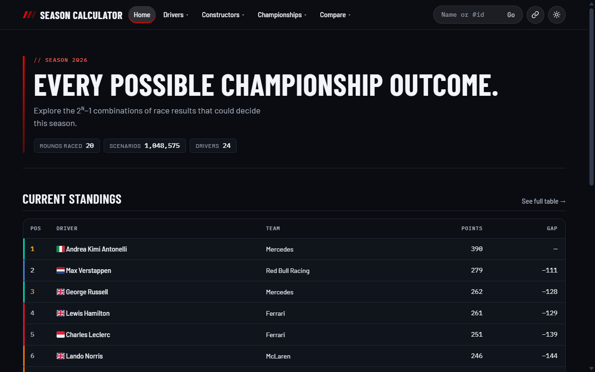
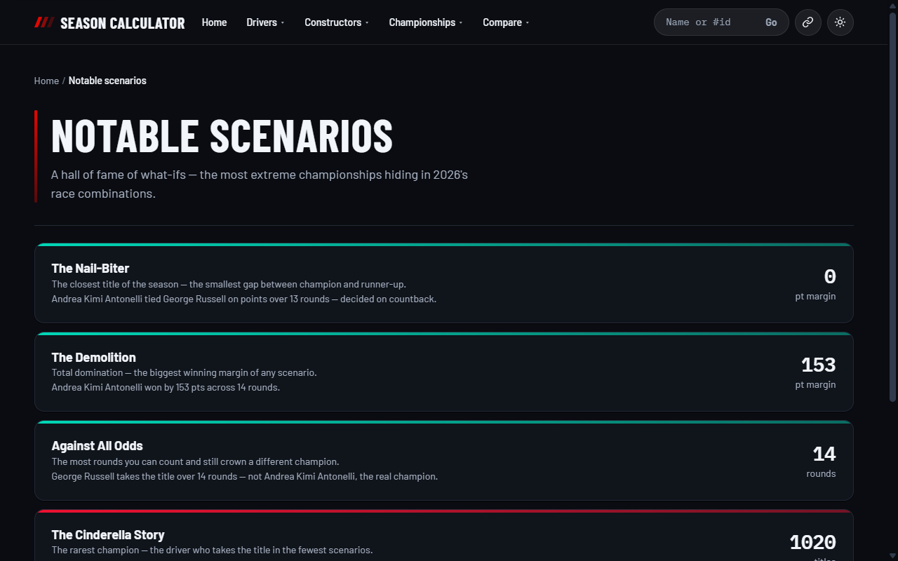
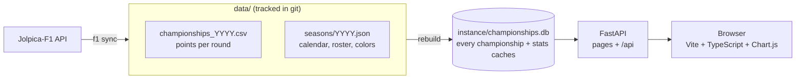

<div align="center">

# 🏎️ F1 Season Calculator

**Every possible Formula 1 championship, scored.**

What if only the first five races had counted? Or every race but Monaco? The
calculator takes a season's results, scores the championship for *every*
combination of race weekends, and shows who wins each one, by how much, and how
often.

[](https://github.com/NikoKiru/F1_Season_Calculator/actions/workflows/ci.yml)
[](https://github.com/NikoKiru/F1_Season_Calculator/actions/workflows/data-sync.yml)
[](https://www.python.org/downloads/)
[](LICENSE)

[Screenshots](#screenshots) · [How it works](#how-it-works) · [Quick start](#quick-start) · [Keeping it current](#keeping-it-current) · [CLI](#cli) · [Docs](#docs)

</div>

## Screenshots

<p align="center">
  
</p>
<p align="center">
  
  
</p>

## Why it's interesting

A season of *n* race weekends has **2ⁿ − 1** possible championships. That is
1,048,575 for a 20-round season and **16,777,215** for a 24-round one, every one
scored and stored, so pages answer instantly instead of computing on demand.

Each scenario picks whole weekends, so a weekend's sprint and race points always
count together. Points ties are split the way the FIA does it: on **countback**,
meaning most wins, then most second places, and so on, counting race finishes
only.

## Features

- **Drivers' and Constructors' championships.** Both are computed for every scenario.
- **Win probability.** Each driver's and team's share of all possible titles, broken down by season length.
- **Notable Scenarios.** The closest title, the biggest blowout, the rarest champion, and the most decisive round.
- **Head-to-head.** Head-to-head between any two drivers across every scenario.
- **Positions.** Every finishing position a driver or team reaches, and the shortest season that gives them the title.
- **Build your own.** Pick any set of rounds and jump to that championship.
- **Self-updating data.** A GitHub Action pulls new results from [Jolpica-F1](https://jolpi.ca) twice a week and commits them.

## How it works



The CSV and season JSON are the source of truth. The SQLite database is derived
from them and can always be rebuilt. Rebuilds are heavy: rows double with every
round, so an 18-round season is about 0.9 GB and takes about 4 minutes.

## Quick start

Needs Python 3.10+ and Node 20.19+ or 22.12+.

```bash
git clone https://github.com/NikoKiru/F1_Season_Calculator.git
cd F1_Season_Calculator
python -m venv .venv
source .venv/bin/activate            # Windows: .venv\Scripts\Activate.ps1
pip install -e .
(cd web && npm ci && npm run build)  # frontend, output goes to app/static/dist/
f1 sync                              # fetch the latest results and build the newest season
uvicorn "app.main:create_app" --factory --host 127.0.0.1 --port 8000
```

Open <http://127.0.0.1:8000>. Interactive API docs are at `/api/docs`.

## Keeping it current

```bash
git pull         # the bot commits new results on Mondays and Thursdays
f1 sync          # fetches anything still missing, rebuilds if the data changed
```

A running server picks up a finished rebuild by itself, so you don't need to
restart it. Run `f1 sync --dry-run` to see the plan without writing anything. Pull
before syncing, because the bot rewrites the same files.

**New season:** run `f1 new-season --season 2027` once Jolpica has the calendar,
then `f1 sync --season 2027`. Colors and team details carry over from the
previous year. Championship titles are edited by hand.

**By hand:** `f1 add-race --season 2026 --race 3 --results "VER:25,NOR:18" [--sprint "VER:8,NOR:7"]`,
or `f1 fetch-race --season 2026 --round 3` for a single round. `python tools/manage_ui.py`
opens a small Tkinter manager with the same buttons.

## CLI

| Command | What it does |
| --- | --- |
| `f1 sync [--season YYYY] [--dry-run]` | Bring a season up to date from Jolpica and rebuild if needed |
| `f1 new-season --season YYYY` | Create `data/seasons/YYYY.json` from Jolpica |
| `f1 fetch-race --season YYYY --round N` | Fetch one weekend's race and sprint results |
| `f1 add-race --season YYYY --race N --results "…"` | Add a weekend's results by hand |
| `f1 refresh-bio --season YYYY` | Update driver and constructor career stats |
| `f1 process-data` / `f1 compute-stats` | Rebuild the drivers' championships and their stats |
| `f1 process-constructors` / `f1 compute-constructor-stats` | Same for constructors |
| `f1 setup` | Create `data/`, `instance/` and a sample CSV |

## Docs

- [CONTRIBUTING.md](CONTRIBUTING.md): dev setup, the checks CI runs, commit conventions
- [CLAUDE.md](CLAUDE.md): architecture, the rebuild pipeline, scale limits, caches
- [data/README.md](data/README.md): CSV format, including sprint columns
- [CHANGELOG.md](CHANGELOG.md): what changed and when

## License

MIT, see [LICENSE](LICENSE).

## Acknowledgments

- [Jolpica-F1](https://jolpi.ca), the Ergast successor that supplies the results.
- [ChainBear](https://www.youtube.com/@ChainBear), whose "what if only these races counted?" videos inspired this.
